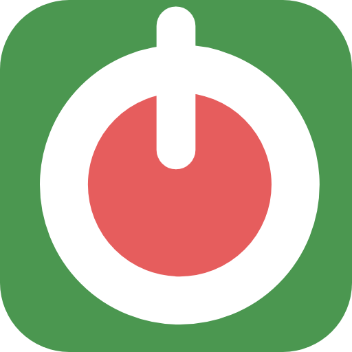

  

# 한걸음 (One Step)

> 앱 개발에 다음 AI 모델들을 활용하였습니다 : **Gemini 4 Hydrogen / Argon / Neon, Gemini 3.8 Flash** (Antigravity), **DeepSeek v4.1 Flash** (Opencode), and **Grok 4.7 / 4.6, Composer 2.5** (Cursor).

목표가 크게 느껴질 때 지금 바로 할 수 있는 작은 행동으로 첫걸음을 떼도록 돕는 Android / Desktop(Windows) 앱입니다.

## 주요 기능

- **즉석 작은 행동 제안**: 사용자 설정 OpenAI 호환 AI 엔드포인트 기반 가벼운 시작 행동 제안
- **학습 경로 & 일일 할 일**: Markdown 자료 기반 단계별 학습 경로, 자가 점검, 매일 반복 할 일 관리
- **빠른 시작**:
  - Android: 홈 화면 위젯(바로 시작 / 일일 할 일), 앱 바로가기, 1탭 바로 시작
  - Desktop: 시스템 트레이, 이동 가능한 미니 바(Mini-bar) 모드, 리마인더
- **로컬 중심 & 동기화**: 기기 내 저장, 같은 Wi-Fi 내 P2P 동기화

## 라이선스

- 소스 코드: [GNU GPL v3 or later](LICENSE) ([`NOTICE`](NOTICE))
- 브랜딩 에셋: [CC BY-SA 4.0](branding/LICENSE)
- 서드파티 고지: [`THIRD_PARTY_NOTICES.md`](THIRD_PARTY_NOTICES.md)
